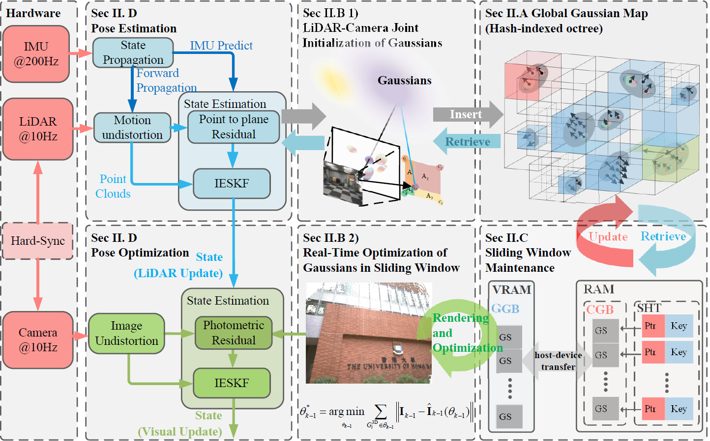
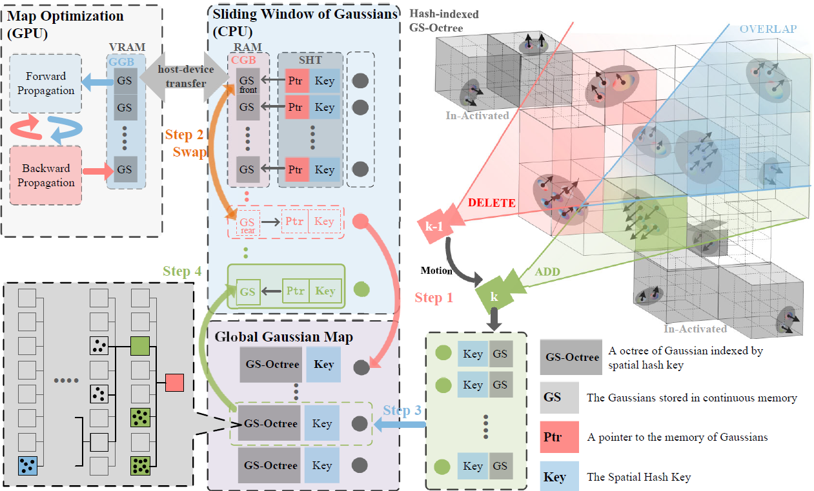

# GS-LIVO DemoPage
Project Page: [gs-livo.tech](https://gs-livo.tech) (coming soon)

This repository shows the experimental results of our GS-LIVO system running on various public datasets and real-world scenarios.

## System Overview and Principles

GS-LIVO (Gaussian Splatting LiDAR-Inertial-Visual Odometry) is a novel SLAM framework that seamlessly integrates LiDAR, inertial, and visual sensors. The system comprises four key modules:



1. **Global Gaussian Map**: A spatial hash-indexed octree structure that efficiently covers sparse spatial volumes while adapting to various environmental details and scales. This structure enables effective management of large-scale environments with minimal memory overhead.

2. **Gaussian Initialization and Optimization**: The system performs rapid initialization of Gaussians using both LiDAR and visual information, followed by online optimization using photometric gradients. This dual-sensor approach ensures robust and accurate scene representation.



3. **Sliding Window Management**: To maintain real-time performance, GS-LIVO employs an innovative sliding window approach for Gaussian maintenance. This includes:
   - Efficient memory management between CPU and GPU
   - Incremental updates to avoid redundant computations
   - Strategic handling of Gaussians entering and leaving the field of view

4. **State Estimation**: The system utilizes an Iterated Extended Kalman Filter (IESKF) with sequential updates, tightly integrating LiDAR and image measurements. Unlike traditional patch-based methods, GS-LIVO achieves seamless rendering with high visual quality.

Key advantages of our approach include:
- Seamless integration of multiple sensor modalities
- Efficient memory management through sliding window optimization
- High-quality scene representation using Gaussian splatting
- Real-time performance on both high-end GPUs and edge computing devices

---

---

## Hardware & Platform Clarification
- **Car Platform & Handheld Platform**: Tested on **Jetson Orin NX (16GB)**


- **Other Datasets (MARS-LVIG, Landmark, UAV, HKU)**: Tested on a **PC with NVIDIA RTX 4090**

---

## Results on MARS-LVIG Dataset
> *These results were produced on PC with NVIDIA RTX 4090.*

### SLAM Process


### SLAM Output Results


---

## Results on Landmark Dataset
> *These results were produced on PC with NVIDIA RTX 4090.*

### SLAM Process


### SLAM Output Results


---

## Results on UAV Playground Dataset
> *These results were produced on PC with NVIDIA RTX 4090.*

### SLAM Process


### SLAM Output Results


---

## Results on FAST-LIVO HKU Dataset
> *These results were produced on PC with NVIDIA RTX 4090.*

### SLAM Process
<!-- HKU1 原始大小 100%，不做缩放 -->


### SLAM Output Results


---

## Vehicle Implementation
> *Tested on Jetson Orin NX (16GB).*

Implementation of GS-LIVO on a real vehicle with A* LQR path planning:


---

## Edge Computing Deployment
> *Tested on Jetson Orin NX (16GB).*

Real-time deployment on Jetson Orin NX 16GB:


---

## Code completion (branch `complete`)

The released code (cc65db2) does not implement the Gaussian mapping described in the paper: each
3 m root voxel keeps a single Gaussian, the sliding-window lookup uses a different voxel size than the
map (so the window stays empty and the photometric update never runs), optimized Gaussians are never
written back, and the build depends on paths of the authors' machine. This branch completes it
following the paper (arXiv:2501.08672):

| Paper | Code |
|---|---|
| II-A global map: spatial hash of root voxels `floor(p / v_s)` (Eq. 1), octree of `max_layer` levels, leaf capacity | `gslivo::GSMap` (`include/gs_map.h`, `src/gs_map.cpp`) |
| II-B.1 LiDAR-camera initialization: planar Gaussian, rotation from the LIO plane normal (Eq. 3), level-based scale (Eq. 2), bilinear colour -> SH DC (Eq. 7) | `GSMap::makeGaussian`, normals from the LIO voxel map in `LIVMapper::handleVIO` |
| II-B.2 photometric optimization of the window with Adam (Eq. 9) | `GSMap::optimize` (masked L1, per-row Adam steps) |
| II-C sliding window: SHT / CGB / GGB, write-back of DELETE voxels, swap-with-rear compaction, OVERLAP / ADD from the LiDAR hash keys, one host-device copy | `GSMap::updateWindow`, `removeRows`, `appendVoxels` |
| II-D IESKF photometric update against the map rendered at the LIO pose (Eq. 10) | `VIOManager::selectGSMeasurements`, `updateStateGS` |

Choices the paper leaves open, and deviations:
- The octree of a root voxel has a fixed depth (`max_layer`); leaves are addressed arithmetically.
- The thin axis `s_delta` of a Gaussian is along the surface normal (Eq. 3 puts the normal in the third
  column of R; Eq. 2 lists `s_delta` first).
- SH degree 0; exposure estimation off (the rendered map is the photometric reference).
- Photometric update: residuals on 8x8 patches (4 pyramid strides) around LiDAR points, one point per
  16x16-pixel cell with the strongest rendered gradient; reference patches from the render at the LIO
  pose. The Jacobian goes through the projection of the point (Eq. 11-12, 15-17); the terms through
  the projected covariance (Eq. 13-14) are omitted.
- Window: voxels leave when their centre leaves the FoV; at the capacity limit the least recently
  observed voxels are evicted (written back to RAM).
- The whole map is written as a standard 3DGS PLY on shutdown (`save_ply:=...` launch argument).

### Build

Dependencies: ROS Noetic (tested with RoboStack on Ubuntu 22.04), CUDA 11.7+ (tested 12.8),
LibTorch (cxx11 ABI, CUDA; tested 2.1.2+cu121), OpenCV, PCL, Eigen, yaml-cpp, nlohmann_json, glm, TBB,
Sophus (non-templated, strasdat/Sophus @ a621ff as for FAST-LIVO2).

```bash
git submodule update --init src/rpg_vikit
P=$PWD/deps; T=/path/to/libtorch
cmake -S src/tinyply    -B build-tinyply    -DCMAKE_INSTALL_PREFIX=$P -DSHARED_LIB=ON && cmake --build build-tinyply --target install
cmake -S src/simple-knn -B build-simple-knn -DCMAKE_INSTALL_PREFIX=$P -DLIBTORCH_DIR=$T && cmake --build build-simple-knn --target install
cmake -S src/lib3dgs    -B build-lib3dgs    -DCMAKE_INSTALL_PREFIX=$P -DLIBTORCH_DIR=$T -DSIMPLE_KNN_DIR=$P \
      "-DCMAKE_PREFIX_PATH=$P" && cmake --build build-lib3dgs --target install
catkin_make -DLIBTORCH_DIR=$T -DGSLIVO_DEPS_DIR=$P      # workspace = this repo (src/gs-livo, src/rpg_vikit)
export LD_LIBRARY_PATH=$P/lib:$T/lib:$LD_LIBRARY_PATH
roslaunch fast_livo mapping_avia.launch save_ply:=/tmp/gaussians.ply
rosbag play CBD_Building_01.bag
```

### Results (FAST-LIVO2 CBD_Building_01, RTX 4090, 640x512)

Root voxel sweep (first 60 s, window 100k unless noted). "Predicted" PSNR: the window rendered at the
tracked pose *before* optimizing on that image, over pixels it covers.

| root voxel / window | predicted PSNR | coverage | GS time / frame |
|---|---|---|---|
| 0.06 m | 20.4 dB | 38% | 51 ms |
| 0.1 m / 200k | 23.5 dB | 86% | 74 ms |
| **0.2 m (default)** | 25.5 dB | 94% | 58 ms |
| 0.5 m | 25.3 dB | 99% | 49 ms |

Whole bag (0.2 m): 1182 / 1187 frames, 0.87 M Gaussians; GS 54 ms (window 5 ms, photometric update
25 ms, 10 Adam iterations 24 ms) + LIO 43 ms per frame. The bag is a 33 m loop without ground truth:
start-to-end error 4.3 cm with the photometric update, 3.7 cm LIO only (poses differ by 8 mm on average).
